<picture>
  <source media="(prefers-color-scheme: dark)" srcset="assets/bren-dark.svg" />
  
</picture>

<i>This is Bren, the mascot of <a href="https://breensivo.app">Breensivo</a>. Say hi. · Este es Bren, la mascota de <a href="https://breensivo.app">Breensivo</a>. Salúdale.</i>

**Christian Bonaque García** · SMR student · Estudiante de SMR · Málaga

 

> **EN** &nbsp; 2nd-year Microcomputer Systems and Networks student at IES Pablo Picasso. Most of my time goes into building with AI: agent teams that plan, code, test, review and audit, and apps with an assistant at their core.
>
> **ES** &nbsp; Estudiante de 2.º de Sistemas Microinformáticos y Redes en el IES Pablo Picasso. Casi todo mi tiempo lo dedico a construir con IA: equipos de agentes que planifican, programan, prueban, revisan y auditan, y apps con un asistente en el centro.

 

  

 

## AI · IA

- **Agentic architecture · Arquitectura agéntica:** multi-agent teams with Claude Code, MCP servers, skills and commands
- **LLMs in products · LLMs en productos:** RAG, model fallback with OpenRouter, an in-app agent that works on real data
- **Voice and video · Voz y vídeo:** ElevenLabs, Whisper timing, automated video with Remotion

## Stack

Networks · Redes: TCP/IP, OSI, routing and switching, Wireshark, DNS, DHCP, Windows Server, Proxmox VE, VirtualBox, LXC

## Projects · Proyectos

| | |
|---|---|
| **[Breensivo](https://breensivo.app)** | Management app for freelancers with an AI agent at its core, built with a team of agents. App de gestión para autónomos con un agente de IA en el centro, hecha con un equipo de agentes. |
| **[Coven](https://github.com/bonaquegar-sudo/coven)** | Security analysis by agents that talk to each other in a Slack-style chat. Análisis de seguridad con agentes que hablan entre ellos en un chat tipo Slack. |
| **[Packet analyzer](https://github.com/bonaquegar-sudo/Analizador-de-paquetes-en-Python)** | Network capture with Scapy and Tkinter, with AI summaries of traffic. Captura de red con Scapy y Tkinter, con resúmenes del tráfico hechos por IA. |
| **[Zaptap](https://zaptap.es)** | NFC cards and a landing page to collect Google reviews. Tarjetas NFC y una landing para conseguir reseñas en Google. |

## GitHub

<picture>
  <source media="(prefers-color-scheme: dark)" srcset="https://github-readme-stats.vercel.app/api?username=bonaquegar-sudo&show_icons=true&hide_border=true&theme=github_dark&title_color=5CBFA9&icon_color=5CBFA9&ring_color=5CBFA9&include_all_commits=true" />
  
</picture>
<picture>
  <source media="(prefers-color-scheme: dark)" srcset="https://streak-stats.demolab.com?user=bonaquegar-sudo&hide_border=true&theme=github-dark-blue&background=111213&ring=5CBFA9&fire=5CBFA9&currStreakLabel=5CBFA9" />
  
</picture>

<picture>
  <source media="(prefers-color-scheme: dark)" srcset="https://github-readme-activity-graph.vercel.app/graph?username=bonaquegar-sudo&hide_border=true&bg_color=111213&color=8b949e&line=5CBFA9&point=e6edf3&area=true&area_color=5CBFA9" />
  
</picture>

 

[bonaquegar@gmail.com](mailto:bonaquegar@gmail.com)

