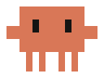

# Hi, I'm Christian · Hola, soy Christian

**Christian Bonaque García**

2nd-year Microcomputer Systems and Networks student (SMR) · I build software with AI agents 
Estudiante de 2.º de Sistemas Microinformáticos y Redes (SMR) · Construyo software con agentes de IA

Málaga, España

---

## About · Sobre mí

**EN** — I study systems and networks at IES Pablo Picasso and spend most of my time building with AI: teams of agents that plan, write code, review it and audit it for security, apps with an assistant at their core, and pipelines that turn a script into a finished video. Before that, web development, systems administration and automation at MalagaMicro.

**ES** — Estudio sistemas y redes en el IES Pablo Picasso y dedico casi todo mi tiempo a construir con IA: equipos de agentes que planifican, programan, revisan y auditan la seguridad, aplicaciones con un asistente en el centro y procesos que convierten un guion en un vídeo terminado. Antes, desarrollo web, administración de sistemas y automatización en MalagaMicro.

---

## AI · Inteligencia artificial

| | EN | ES |
|---|---|---|
| **Agentic architecture** | Multi-agent teams with defined roles (tech lead, developer, tester, reviewer, security) coordinated with Claude Code | Equipos de varios agentes con roles definidos (jefe técnico, desarrollo, pruebas, revisión, seguridad) coordinados con Claude Code |
| **Tools for agents** | MCP servers, custom skills and slash commands | Servidores MCP, skills propias y comandos |
| **LLMs in products** | RAG over a knowledge base, model fallback with OpenRouter, an in-app assistant that acts on real data | RAG sobre una base de conocimiento, modelo de respaldo con OpenRouter y un asistente dentro de la app que trabaja con datos reales |
| **Voice and video** | ElevenLabs voices, Whisper word-level timing and automated video with Remotion | Voces con ElevenLabs, tiempos palabra a palabra con Whisper y vídeo automático con Remotion |

  &nbsp;&nbsp;
  &nbsp;&nbsp;
  &nbsp;&nbsp;
  &nbsp;&nbsp;
  

---

## Stack

**Programming · Programación**

<picture>
  <source media="(prefers-color-scheme: dark)" srcset="https://skillicons.dev/icons?i=py,ts,react,nextjs,nodejs,postgres,supabase,tailwind,astro,fastapi,flask,vercel&theme=dark" />
  
</picture>

**Systems and networks · Sistemas y redes**

<picture>
  <source media="(prefers-color-scheme: dark)" srcset="https://skillicons.dev/icons?i=linux,debian,windows,bash,docker,git,github&theme=dark" />
  
</picture>

TCP/IP and OSI · routing and switching · Wireshark · DNS · DHCP · Windows Server · Proxmox VE · VirtualBox · LXC

---

## Projects · Proyectos

**[Breensivo](https://breensivo.app)**
- **EN:** Management app for freelancers and small businesses: invoices, expenses, calendar and tasks, with an AI agent (Bren) at its core. Built and run with a team of AI agents.
- **ES:** App de gestión para autónomos y pymes, con facturas, gastos, agenda y tareas, y un agente de IA (Bren) en el centro. Hecha y mantenida con un equipo de agentes de IA.

**[Coven](https://github.com/bonaquegar-sudo/coven)**
- **EN:** Security analysis of projects by a team of agents that talk to each other in a Slack-style chat.
- **ES:** Análisis de seguridad de proyectos con un equipo de agentes que hablan entre ellos en un chat tipo Slack.

**[Analizador de paquetes](https://github.com/bonaquegar-sudo/Analizador-de-paquetes-en-Python)**
- **EN:** Network traffic capture with Scapy and Tkinter, with AI summaries of traffic patterns.
- **ES:** Captura de tráfico de red con Scapy y Tkinter, con resúmenes de patrones hechos por IA.

**[Zaptap](https://zaptap.es)**
- **EN:** NFC cards and a landing page that help local businesses collect Google reviews.
- **ES:** Tarjetas NFC y una landing que ayudan a negocios locales a conseguir reseñas en Google.

---

## Contact · Contacto

[bonaquegar@gmail.com](mailto:bonaquegar@gmail.com)
